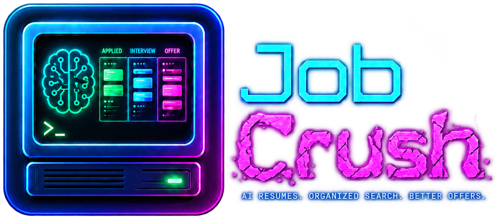

<p align="center">
  
</p>

<p align="center">
  <a href="https://github.com/ultramanjones/jobcrush/actions/workflows/build.yml"></a>
</p>

<p align="center"><b>Organize. Personalize. Get Hired.</b></p>

A desktop command center for the job search, in **Qt Quick / C++**. Applications live on a kanban pipeline, documents are prepared and staged before any job portal is opened, and an interchangeable **AIBrain** helps parse postings and draft cover letters — while the human makes every call that matters.

## Why it exists

One night mid-job-search, a fifteen-minute task took three hours — and by the time the application was finally ready, the portal went into maintenance before the resume could be submitted.

Job Crush exists so that never happens again. Everything is prepared, reviewed and staged **first**, and the portal visit becomes the short mechanical last step instead of the whole evening.

## Architecture — VVMLM

Not MVVM. **VVMLM** (View, ViewModel, Logic, Model) is MVVM's rightful successor: the same idea with the missing layer named and given a home.

```
            View          QML only. Zero business logic. Rip the face off and
              │           everything still works. View objects never talk to
              ▼           each other — navigation is signalled up to Main.

          ViewModel       C++ that knows nothing about QML. Headless and
              │           testable. Translation and organization ONLY.
              ▼           Named for the DATA served, never for the screen.

            Logic         The whole back end. Faces both directions: wraps
              │           the data core below, hands prepared data up. See
              ▼           below — this layer is the entire point.

            Model         Data records and repositories wrapping SQLite.
                          SQL lives here and nowhere else.
```

The Logic layer was first called ModelView. It was renamed because Qt already uses the words "model/view" for its own classes. Older commits use the old name.

### The Logic layer is not a "service layer"

Call this layer a *service layer* and you have described maybe a fifth of it. "Service" implies things that go **out** — network calls, external systems. Most of what lives here never leaves the machine. The Logic layer is:

- **the data wrapper** — everything above it asks for prepared data and never learns that SQLite exists (swap in a cloud back end and nothing above this layer changes)
- **calculation logic** — ranking, scoring, deduplication, aggregation, anything that computes an answer rather than displaying one
- **orchestration** — coordinating several repositories or several outward calls into one coherent operation
- **policy and rules** — routing order, which credential wins, what counts as the same job across two sources
- **outward integrations** — the HTTP clients, the AI vendors, the job boards (the part that actually *is* a service layer)
- **format translation** — vendor JSON in, domain types out, so no wire format ever leaks upward
- **caching and freshness** — what is still true, and when it is worth asking again
- **long-lived domain state** — a running conversation, a credential roster, a search profile

And here is why the misnomer matters, in practice rather than in theory: if you believe the layer is *for services*, then a calculation "isn't a service call," so it has nowhere to go — and it drifts up into the viewmodel because that is the nearest place with a pulse. Do that for three months and the viewmodels are god objects, the layering is decorative, and nobody can say when it happened.

Name the layer for everything it holds and that drift has nowhere to start. The ViewModel stays thin because there is somewhere better for the work to live.

### The rule is checkable

The dependency arrow points one way only, and the folders are the rule — which makes the architecture verifiable rather than aspirational. In thirty seconds you can confirm that:

- no SQL appears above `src/model/`
- no QML or Qt Quick header appears inside `src/viewmodel/`
- nothing in `src/model/` includes anything from a layer above it
- there is exactly one composition root, and it is `src/main.cpp` (the AI app bridge in `tools/ai-app-bridge/` is a separate small program with its own `main`)

```
src/
├── view/                   QML only; hand-written components, no Qt Widgets
├── viewmodel/              QAbstractListModel subclasses and small state
├── logic/                  the back end
│   ├── activejobs/         the Active Jobs folder: one JobQuest.txt per job
│   ├── aiapps/             the actions AI apps can ask for, over MCP
│   ├── aibrain/            pluggable AI providers, credential roster, the soul
│   ├── brainchat/          the conversation itself
│   ├── exporting/          Word, PDF and text output
│   ├── jobscout/           job-site clients, search profile, prospect scoring
│   ├── pipelines/          the application board and its rules
│   ├── prodocs/            resume and document intake
│   ├── stats/              the numbers on the Stats page
│   └── tasks/              application packets
├── model/                  data records + repositories; the only place SQL lives
├── ViewModelQmlTypes.h     gives QML each viewmodel's type, from outside the viewmodel folder
└── main.cpp                the composition root — everything wired by hand
tests/                      headless QtTest programs, one per class under test
tools/                      the AI app bridge and the Windows installer
```

Dependency injection is constructor injection, by hand, in that one composition root. No container, no framework.

## Reading it

Rather than browsing folders, follow one feature straight down through all four layers:

**Discoveries** — the page that lists the jobs Job Crush found and ranks them.

1. View: `src/view/DiscoveriesPage.qml`
2. ViewModel: `src/viewmodel/DiscoveredJobListViewModel.h` and `.cpp`
3. Logic: `src/logic/jobscout/JobScout.h` and `.cpp`, with `DiscoveryWorker` (saves and ranks found jobs on a background thread, so the window never freezes) and `ProspectScorer` (the match score)
4. Model: `src/model/JobPostingRepository.h` and `.cpp`

Ten minutes, and the layering either convinces you or it doesn't.

Two places in that slice worth a closer look:

- **`src/logic/jobscout/ProspectScorer.cpp`** — job ranking as a self-contained deterministic algorithm. Its weights are named constants in a single block, so tuning it means editing numbers rather than hunting through arithmetic.
- **`src/logic/jobscout/JobSourceProvider.h`**, and its twin **`src/logic/aibrain/AiBrainProvider.h`** outside the slice — the same seam solved twice on purpose. Adding a job board or an AI vendor is one new class and a few lines to register it; nothing above either interface changes.

## What runs today

- **Brain Chat** — streaming responses over SSE, system prompt assembled from user-editable soul files, honest degraded mode with no key configured.
- **Brain selector** — Anthropic, Google Gemini, OpenAI and OpenRouter with the user's own key, or Ollama on the user's own machine with no key. A checkbox picks the active brain, verified by a real zero-token call to the vendor. A tick means connected and active and nothing weaker. Each brain has three levels, Quick, Balanced and Best, with the vendor's model name shown small.
- **JobScout** — pluggable job-site clients: general boards (Remotive, Arbeitnow, Jobicy, USAJOBS) and employers' own hiring systems (Greenhouse, Lever, Ashby, SmartRecruiters, Workday, Taleo). Per-site tabs, cross-source deduplication, and **Top Prospects** ranked by a local algorithm that costs no API calls and no AI tokens, showing its reasons on every row.
- **Manual Add** — paste a link, or type a company and title. Job Crush hunts down the employer's own posting and keeps the employer's words.
- **Job Pipelines** — the application board, from Crushed through Applied, Interview, Offer and Closed. It can check whether a posting is still listed. A job is marked gone only when two separate answers from the company's own board agree, and the user can overrule it.
- **ProDocs** — drop in resumes, cover letters and transcripts (Word, PDF or text). Work history and education are read out of them.
- **Staging and export** — an application packet per job, written out as Word, PDF or text before the job portal is ever opened.
- **Stats** — the numbers on the search so far.
- **Active Jobs folder** — one folder and one plain-text `JobQuest.txt` per job, so an outside AI can add and update jobs too.
- **Data core** — SQLite behind repositories, with schema that grows by adding columns rather than discarding anyone's data. Saving and ranking thousands of found jobs runs on a background thread with its own connection, so the window never stops responding.

What is coming next, what is deliberately parked, and why, is in
[BACKLOG.md](BACKLOG.md).

## Conventions

Long explicit `camelCase` names — code is written for humans. In-house subsystems get identity names (`AIBrain`, `JobScout`, `ProDocs`) so they read differently from framework API. Dense logic is commented heavily. No Qt Widgets anywhere: the QML components are hand-written and meant to be read.

## Building

Requires Qt 6.5+ and CMake 3.21+. CI builds on Windows and Linux against Qt 6.8.

```
cmake -S . -B build -DCMAKE_BUILD_TYPE=Release
cmake --build build
```

Or open `CMakeLists.txt` in Qt Creator and hit Run.

### The Windows installer

`JobCrushSetup-<version>.exe` is the one file a person downloads to get Job
Crush. It installs for the current user, with no administrator password, and
includes everything Qt needs.

The easy way is GitHub: Actions tab, "Windows installer", "Run workflow". Or
push a version tag (`git tag v0.1.0; git push origin v0.1.0`) and the
installer is attached to a GitHub Release for that tag.

To make it on your own Windows computer, install [Inno Setup
6](https://jrsoftware.org/isdl.php), then run from this folder:

```
powershell -ExecutionPolicy Bypass -File tools\installer\build-installer.ps1
```

### AI apps

`jobcrush-ai-bridge` is a second, small program built next to Job Crush. AI
apps such as Claude desktop start it to work the board through MCP (Model
Context Protocol). It passes each request to the running Job Crush and never
touches the database itself. Settings shows the text to paste into Claude
desktop.

## Testing

The tests in `tests/` build the Logic classes on their own, with no window
and no network. They cover the job scorer, the search profile, the date
reader, the Workday, SmartRecruiters and Taleo readers, the JobQuest.txt file, the
shipped company list, the Active Jobs folder, the background worker that saves
and ranks found jobs, and the check that decides whether a job is gone (with a
fake board in place of the network). Tests that need a database make their own
in a temporary folder, so no test touches real data. CI runs them on Windows
and Linux on every push.

```
ctest --test-dir build --output-on-failure
```

## License

MIT — see [LICENSE](LICENSE).
